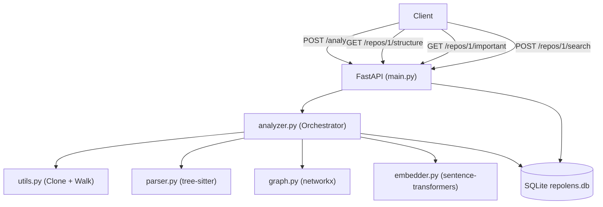

# RepoLens

> A code analysis engine for GitHub repositories — understand any codebase in seconds.

RepoLens clones a GitHub repo, parses every Python and JavaScript file, builds a map of how the code connects, and exposes everything through a clean REST API. Designed as a portfolio project by a CS student, for CS students.

---

## Architecture



**Data flow for a fresh analysis:**
1. Client sends a GitHub URL
2. `utils.py` clones the repo to `repos/`
3. `parser.py` reads each `.py` / `.js` file with tree-sitter and extracts functions, classes, imports
4. `graph.py` builds a directed graph and runs PageRank
5. `embedder.py` converts every function/class into a meaning vector using a local AI model
6. Everything is stored in SQLite, including file hashes so unchanged files are skipped on re-run

---

## Quick Start

### 1. Prerequisites

- Python 3.11 or higher
- Git (must be in PATH)
- ~1 GB free disk (for PyTorch and the AI model)

### 2. Set Up

```bash
# Clone this repo
git clone https://github.com/your-username/repolens.git
cd repolens

# Create a virtual environment
python -m venv venv

# Activate it
# Windows:
venv\Scripts\activate
# Mac/Linux:
source venv/bin/activate

# Install all dependencies (takes ~2 minutes the first time)
pip install -r requirements.txt
```

### 3. Run the Server

**Windows (recommended — sets UTF-8 encoding automatically):**
```bash
start.bat
```

**Or manually:**
```bash
# Windows — set encoding first to avoid git Unicode errors:
$env:PYTHONIOENCODING="utf-8"; $env:PYTHONUTF8="1"; uvicorn app.main:app --reload

# Mac/Linux:
uvicorn app.main:app --reload
```

The server starts at **http://localhost:8000**
Interactive API docs: **http://localhost:8000/docs**

---

## Example API Calls

### Analyze a Repo

```bash
curl -X POST http://localhost:8000/analyze \
     -H "Content-Type: application/json" \
     -d "{\"url\": \"https://github.com/pallets/flask\"}"
```

**Response:**
```json
{
  "repo_id": 1,
  "url": "https://github.com/pallets/flask",
  "files_processed": 42,
  "message": "Done. 42 files parsed, 0 unchanged (skipped)."
}
```

---

### Get the Code Structure

```bash
curl http://localhost:8000/repos/1/structure
```

**Response (trimmed):**
```json
{
  "repo_id": 1,
  "files": [
    {
      "path": "src/flask/app.py",
      "language": "python",
      "symbols": [
        {"kind": "class",    "name": "Flask",  "start_line": 90,  "end_line": 1200},
        {"kind": "function", "name": "run",    "start_line": 940, "end_line": 980}
      ],
      "imports": ["os", "sys", "click", "werkzeug"]
    }
  ]
}
```

---

### Find the Most Important Files

```bash
curl http://localhost:8000/repos/1/important
```

**Response:**
```json
{
  "repo_id": 1,
  "files": [
    {"path": "src/flask/app.py",     "score": 0.042, "rank": 1},
    {"path": "src/flask/helpers.py", "score": 0.038, "rank": 2}
  ]
}
```

---

### Search by Meaning

```bash
curl -X POST http://localhost:8000/repos/1/search \
     -H "Content-Type: application/json" \
     -d "{\"query\": \"where is request routing handled?\", \"top_k\": 3}"
```

**Response:**
```json
{
  "repo_id": 1,
  "query": "where is request routing handled?",
  "results": [
    {
      "file_path": "src/flask/app.py",
      "symbol_name": "add_url_rule",
      "kind": "function",
      "start_line": 402,
      "end_line": 460,
      "score": 0.7821,
      "snippet": "def add_url_rule(self, rule, endpoint=None, view_func=None..."
    }
  ]
}
```

---

### Re-Run (Fast)

Just POST the same URL again. Files that have not changed are skipped:

```bash
curl -X POST http://localhost:8000/analyze \
     -H "Content-Type: application/json" \
     -d "{\"url\": \"https://github.com/pallets/flask\"}"
```

Response: `"Done. 0 files parsed, 42 unchanged (skipped)."`

---

### List All Analyzed Repos

```bash
curl http://localhost:8000/repos
```

---

## Running Tests

```bash
pytest tests/ -v
```

Note: `test_embedder.py::TestEmbedText` loads the AI model (~80 MB download on first run). Subsequent runs are fast because the model is cached.

---

## Project Structure

```
RepoLen/
├── app/
│   ├── main.py        # FastAPI routes (the API layer)
│   ├── analyzer.py    # Orchestrator (ties everything together)
│   ├── parser.py      # tree-sitter code parser
│   ├── graph.py       # networkx dependency graph + PageRank
│   ├── embedder.py    # sentence-transformers + numpy search
│   ├── database.py    # SQLite setup
│   ├── models.py      # Pydantic request/response models
│   └── utils.py       # File walking, git clone, hashing
├── tests/
│   ├── test_parser.py
│   ├── test_graph.py
│   ├── test_embedder.py
│   └── test_rerun.py
├── docs/
│   └── EXPLAINED.md   # Plain-English explanation of everything
├── requirements.txt
└── README.md
```

---

## Limitations (Being Honest)

| Limitation | Why |
|---|---|
| Public repos only | We use plain git clone with no auth tokens |
| Python and JS only | tree-sitter grammars are only set up for these two |
| Import resolution is best-effort | We match module names to file paths using simple heuristics; complex cases may not resolve |
| No incremental graph updates | The full dependency graph is rebuilt on every analysis |
| No streaming responses | Large repos (1000+ files) may take 1-5 minutes for the initial analysis |
| Single-process SQLite | Fine for local use; would need Postgres for multiple concurrent users |
| Model is 80 MB | Downloads automatically on first run; needs internet access once |

---

## Good Commit Messages

```
feat: add project skeleton, database schema, and utility helpers
feat: add tree-sitter parser for Python and JavaScript
feat: add networkx dependency graph and PageRank file ranking
feat: add sentence-transformers semantic search with numpy cosine similarity
feat: add file hashing for fast re-run (skip unchanged files)
feat: add FastAPI routes for all four endpoints
test: add pytest tests for parser, graph, embedder, and re-run logic
docs: add README with architecture diagram, API examples, and limitations
docs: add EXPLAINED.md with plain-English walkthrough for beginners
```
